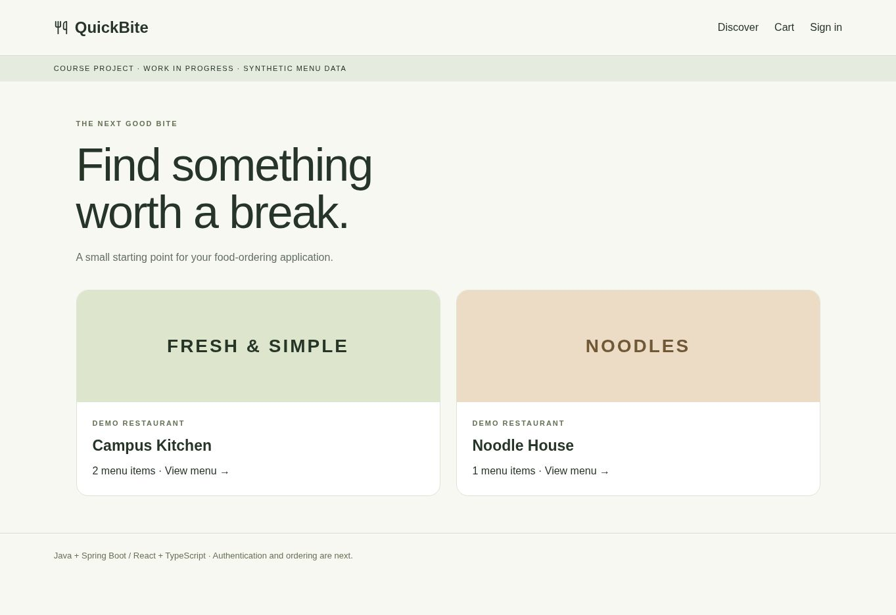
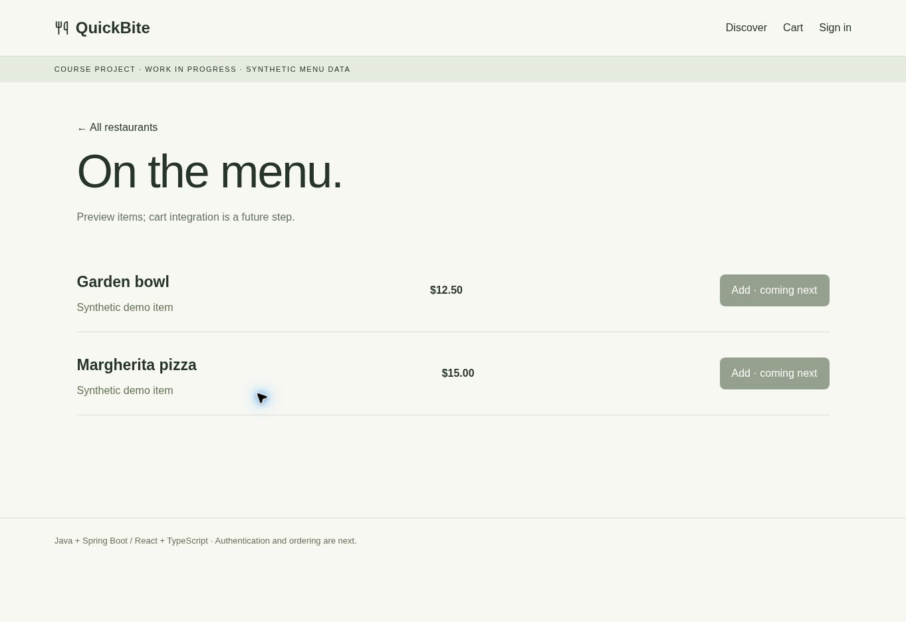
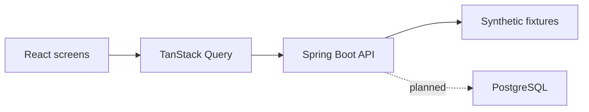

# QuickBite

### Restaurant discovery and menu browsing

A full-stack food-ordering project built with a Java API and a typed React client. The current demo connects restaurant discovery and menu screens to live backend endpoints serving synthetic data.

**Java 21 · Spring Boot 4 · React · TypeScript · TanStack Query · Tailwind CSS**

[Run locally](#run-locally) · [API contract](docs/API.md) · [Development roadmap](docs/NEXT_STEPS.md)



*Actual browser capture: restaurant cards loaded from the running Spring Boot API.*

<details>
<summary>View the restaurant menu screen</summary>



*Menu items and prices come from synthetic API fixtures. Cart actions are not implemented yet.*

</details>

## Engineering highlights

- React Router separates discovery and restaurant menus; TanStack Query manages API data.
- Spring Boot exposes restaurant/menu endpoints with a documented snake_case contract.
- Smoke checks cover startup, menu responses, anonymous cart rejection and unknown restaurants.
- Entity definitions, repository interfaces and a PostgreSQL schema prepare the next persistence milestone.

## Architecture



## Current scope

| Working local demo | Next milestones |
| --- | --- |
| Restaurant discovery and menu browsing | Database-backed services |
| Public API and protected-route 401 responses | Signup and session login |
| Typed frontend client and validation workflow | Cart, checkout and deployment |

**Status: runnable scaffold, in active development.** The demo does not process payments, persist orders or implement authentication. [Screenshot reproduction](docs/SHOWCASE.md).

## Run locally

Prerequisites: JDK 21, Node 22.12+ (or a newer supported LTS), npm. The Gradle wrapper pins Gradle 9.3.0.

```sh
cd backend
./gradlew bootRun
```

In another terminal:

```sh
cd frontend
npm ci
npm run dev
```

Open http://localhost:5173. Vite forwards `/api/*` to `http://localhost:8080/*` and strips `/api`, matching the course backend paths. The starter uses synthetic menu data and does not require a database to boot.

On Windows PowerShell, use `.\gradlew.bat` instead of `./gradlew`.

## Database preparation (optional, not wired into the starter)

Copy the root `.env.example` to `.env`, choose a local database password, then run `docker compose up -d`. PostgreSQL is bound to loopback. The schema initializes a new volume only and never drops tables. The starter backend intentionally uses the `spring-data-jdbc` library without the Boot JDBC starter; swap to `spring-boot-starter-data-jdbc`, configure the datasource, and replace fixture services when implementing Lesson 9–11 persistence.

## Validate

```sh
cd frontend
npm run typecheck
npm run build
cd ../backend
./gradlew test bootJar
cd ..
python3 scripts/smoke_test.py
```

The smoke test checks server startup, snake_case menus, an anonymous cart returning 401, and an unknown restaurant returning 404. No cloud resources are provisioned by this repository.

## Continue development

Start with [development roadmap](docs/NEXT_STEPS.md), [course mapping](docs/COURSE_MAP.md), [API contract](docs/API.md) and [architecture](docs/ARCHITECTURE.md).
Preserve your existing authentication code when merging it later. No license is granted for the original course material, and the source document itself is not included.
